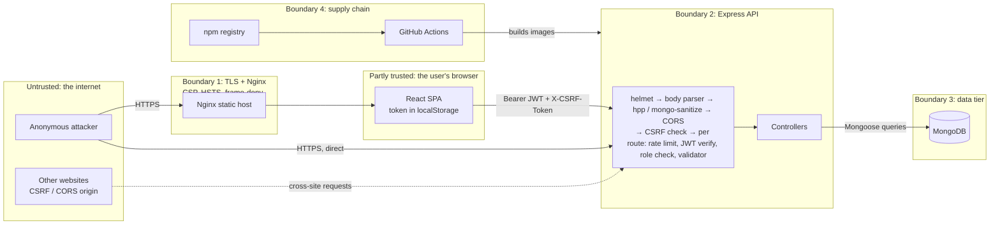

# Security case study: an international payments portal

This is a security review of a payments portal I led as a team project for INSY7314 (Secure Software Development). We built it as coursework. Afterwards I went back to it as an attacker would, to see how well the controls we had added actually held up. This document covers the threat model, how the controls map to the OWASP Top 10, the attacks I ran, what broke, how I fixed it, and what is still open.

**Results at a glance**

- I wrote 12 scripted attacks against the API ([`Backend/scripts/attack-demo.js`](../Backend/scripts/attack-demo.js)). Against the code as submitted, **6 succeeded**. After the fixes, **all 12 are blocked**.
- I fixed 16 issues, each in its own commit with a test. The most serious was a broken access-control path: **customers could approve their own payments**, and the frontend did it automatically for every payment, so the employee review step never happened.
- A second finding was easy to miss: the input sanitisers (`express-mongo-sanitize`, `xss-clean`) were registered **before** the JSON body parser, so they never saw a request body.
- Tests: 47 backend tests pass, 25 of them attack scenarios. A new GitHub Actions workflow runs the tests, the attack demo, an `npm audit` gate, gitleaks and CodeQL on every pull request.
- Open risks are listed honestly in [section 7](#7-remaining-risks). The largest is that the session token lives in `localStorage`.

---

## 1. The system

| Part | Technology | Notes |
|------|------------|-------|
| Customer and staff UI | React 18 single-page app (Create React App), served by Nginx | Customer portal plus an employee/admin portal |
| API | Node.js, Express 4 | `Backend/` holds the routes, middleware and controllers |
| Database | MongoDB with Mongoose 8 | Users, employees, payments |
| Auth | JWT (HS256) in an `Authorization: Bearer` header; bcrypt (cost 12) password hashes | Customer tokens last 1 h, employee tokens 8 h |
| Deployment | Docker Compose; mkcert certificates for local HTTPS | No certificates or keys are committed (see 6.4) |

**Roles**

- **Customer**: registers with full name, 10-digit account number, 13-digit national ID and a password. Submits international payments and can withdraw them while they are pending.
- **Employee**: reviews pending payments and approves or denies them.
- **Admin**: everything an employee can do, plus creating and deleting employee accounts. The *super admin* (seeded once, `createdBy: null`) is the only account that can create or delete other admins.

---

## 2. Threat model

### 2.1 Assets

| Asset | Why it matters |
|-------|----------------|
| Payment records and their **status** | Status decides whether money moves. Changing it without authorisation is fraud. |
| The approval **audit trail** (`processedBy`, `processedAt`) | Needed to show who approved what, for disputes and for regulators. |
| Customer personal data: national ID, account number, name | National IDs cannot be changed once leaked. South Africa's POPIA applies. |
| Credentials: password hashes, the JWT signing secret, live tokens | Whoever holds the JWT secret can mint an admin token. |
| Staff accounts and roles | An admin account can create more staff accounts. |
| Availability of login and payment submission | Brute force and abuse both go through these endpoints. |

### 2.2 Actors

| Actor | Starting position | Wants to |
|-------|-------------------|----------|
| Anonymous internet attacker | Can reach the frontend and the API | Take over accounts (brute force, injection), harvest personal data, abuse CORS or CSRF from another site |
| Malicious or curious customer | Holds a valid customer token | Approve their own payments, read other customers' payments, act with staff rights |
| Insider employee | Holds a valid employee token | Act beyond their role, cover their tracks, keep access after leaving |
| Rogue or compromised admin | Holds an admin token | Create accounts for themselves, delete the super admin |
| Supply-chain attacker | Controls an npm dependency, or an attacker who finds a leaked secret in the repository | Run code in the build or at runtime, mint tokens |

### 2.3 Trust boundaries



| Boundary | What crosses it | Main threats | Controls |
|----------|-----------------|--------------|----------|
| 1. Internet → browser and Nginx | HTML, JavaScript, user input | XSS, clickjacking, downgrade to HTTP | React output encoding, CSP, `X-Frame-Options: DENY`, HSTS |
| 2. Browser or attacker → API | JSON requests carrying bearer tokens | Injection, broken access control, brute force, CSRF, CORS abuse, token forgery | Validators, sanitiser, role middleware, per-user query scoping, rate limits, CSRF double-submit, CORS allow-list, HS256 algorithm pinned |
| 3. API → MongoDB | Queries and documents | NoSQL injection, data exposure, race conditions | Mongoose query builder, string-only inputs, atomic updates, DB not published beyond localhost |
| 4. Supply chain → build | Dependencies, CI | Malicious or vulnerable packages, leaked secrets | Lockfiles with `npm ci --ignore-scripts` in Docker builds, `npm audit` gate, gitleaks, CodeQL |

The API is also reachable **directly** (port 5000 is published), not only through Nginx. That matters for anything that trusts proxy headers (finding F4).

---

## 3. OWASP Top 10 (2021) mapping

Each row lists the controls that exist in the code, with links, followed by what this review changed.

| OWASP 2021 | Controls in this repository | Found and fixed in this review |
|------------|-----------------------------|--------------------------------|
| **A01 Broken Access Control** | Customer routes require a customer token ([`authMiddleware.js`](../Backend/Middleware/authMiddleware.js)). Staff routes require an employee token plus a role check ([`employeeAuthMiddleware.js`](../Backend/Middleware/employeeAuthMiddleware.js), wired in [`employeeRoutes.js`](../Backend/Routes/employeeRoutes.js)). Every customer query is scoped with `.where('userId').equals(userId)` ([`paymentController.js`](../Backend/Controller/paymentController.js)). Super-admin rules live in [`adminController.js`](../Backend/Controller/adminController.js). | F1 customers could set payment status. F2 customers could delete processed payments. F5 deleted or demoted staff kept their access. F8 employee tokens were accepted on customer routes. |
| **A02 Cryptographic Failures** | bcrypt with cost 12 ([`userModel.js`](../Backend/Models/userModel.js), [`employeeModel.js`](../Backend/Models/employeeModel.js)); HS256 JWTs with expiry; HSTS; local HTTPS with mkcert; `certs/*.pem` and `*.key` are git-ignored | F12 the server now refuses to start with a missing, short or placeholder JWT secret ([`configCheck.js`](../Backend/Services/configCheck.js)). The algorithm is pinned on verify. |
| **A03 Injection** | `express-validator` allow-lists ([`validationMiddleware.js`](../Backend/Middleware/validationMiddleware.js), [`employeeValidationMiddleware.js`](../Backend/Middleware/employeeValidationMiddleware.js)); `express-mongo-sanitize`; Mongoose query builder; React escapes output; CSP | F3 the sanitisers ran before the body parser, so they never saw a body. The validators now require strings. |
| **A04 Insecure Design** | Payments must be approved by staff; staff portal separate from the customer portal | F1 the approval step could be skipped. F6 two employees could approve and deny the same payment at once. |
| **A05 Security Misconfiguration** | helmet ([`securityMiddleware.js`](../Backend/Middleware/securityMiddleware.js)); CORS allow-list; 200 kB body limit; generic 404 and 500 responses; non-root containers | F4 `trust proxy` was always on. F9 500s leaked internal errors. F14 Nginx lost its headers on static files, and there was no CSP. F15 MongoDB was published on all interfaces. F16 denied CORS requests produced 500s. |
| **A06 Vulnerable and Outdated Components** | Lockfiles; `npm ci`; CircleCI audit, gitleaks and Trivy (all non-blocking) | F13 removed the unused, archived `csurf`; backend production dependencies now audit clean. Removed the deprecated `xss-clean`. Added a blocking audit gate in [`security.yml`](../.github/workflows/security.yml). |
| **A07 Identification and Authentication Failures** | Login and registration rate limits ([`rateLimitMiddleware.js`](../Backend/Middleware/rateLimitMiddleware.js)); the same "Invalid credentials" message for both failure cases; token denylist on logout; short-lived tokens | F4 rate limits could be bypassed. F10 response timing revealed which accounts exist. F11 the password minimum was 6 characters. F5 revocation. |
| **A08 Software and Data Integrity Failures** | Lockfiles; `npm ci --ignore-scripts` in Dockerfiles | The new CI workflow runs gitleaks over the whole history, and CodeQL. |
| **A09 Security Logging and Monitoring Failures** | Request IDs, start and end logs, sensitive-key masking ([`loggerMiddleware.js`](../Backend/Middleware/loggerMiddleware.js)); `processedBy` and `processedAt` on payments | F7 national IDs and account numbers were written to the logs, and tokens and personal data to the browser console. Failed CSRF checks are now logged. |
| **A10 Server-Side Request Forgery** | Not applicable: the API makes no outbound requests based on user input. | none |

---

## 4. Attack scenarios tested

I tested in two ways, and both are in the repository.

1. **Attack-scenario test suite**, [`Backend/__tests__/security.test.js`](../Backend/__tests__/security.test.js) and [`rateLimit.test.js`](../Backend/__tests__/rateLimit.test.js). Each test performs an attack and asserts that it is blocked. I committed the suite before any fix and marked the attacks that worked with Jest's `test.failing`. Each fix commit then changes one or more of those to `test`, so the diff of a fix shows exactly which attack it closes.
2. **Attack demo**, [`Backend/scripts/attack-demo.js`](../Backend/scripts/attack-demo.js). It starts the API with CSRF enforcement on, against a throwaway in-memory MongoDB, runs the attacks through the same request pipeline the browser uses, and prints a report. It exits non-zero if any attack succeeds, and CI runs it.

```bash
cd Backend && npm ci && npm run demo:attacks
```

**Results: the original code compared with this branch**

| # | Attack | Before | After |
|---|--------|--------|-------|
| 1 | NoSQL injection: log in with `{"$ne": null}` as the password and name | Blocked, but only by chance: no token was issued, yet the operator object reached the database query (HTTP 401) | **Blocked** by validation (HTTP 400) |
| 2 | Brute force while rotating `X-Forwarded-For` | **Succeeded**: never throttled in 20 guesses | **Blocked**: 429 after 5 guesses |
| 3 | Customer sets their own payment to `completed` | **Succeeded**: HTTP 200, payment marked completed | **Blocked**: the route no longer exists, payment stays pending |
| 4 | Customer deletes an approved payment | **Succeeded**: HTTP 200, record gone | **Blocked**: HTTP 409 |
| 5 | IDOR: Bob reads Alice's payment by its id | Blocked (404) | Blocked (404) |
| 6 | Employee token used on customer routes | **Succeeded**: HTTP 200 | **Blocked**: HTTP 403 |
| 7 | Unsigned JWT (`"alg": "none"`) | Blocked (403) | Blocked (403) |
| 8 | Admin token forged with a guessed secret | Blocked (403) | Blocked (403) |
| 9 | Deleted employee keeps using their token | **Succeeded**: HTTP 200 for up to 8 hours | **Blocked**: HTTP 401 |
| 10 | Two employees approve and deny the same payment at once | **Succeeded**: both got 200, last write won | **Blocked**: 200 and 409 |
| 11 | Cross-site POST without the CSRF token | Blocked (403) | Blocked (403) |
| 12 | `https://evil.example` requests CORS read access | Blocked (no grant) | Blocked (no grant) |

The test suite also covers things the demo does not: a demoted admin losing admin rights straight away, expired tokens, `$where` keys in payment metadata, the password policy, a timing check (bcrypt runs even for unknown accounts), PII never appearing in logs, 500 responses not echoing internal errors, and the security headers.

18 tests in the original coursework suite (`health.test.js`) are still skipped, as they were at submission. Most of them fail only because of test order: they log in through the real endpoints and run into the login rate limit that earlier tests have already used up. The attack suite covers the same ground, but signs tokens directly so the tests do not depend on each other.

---

## 5. Gaps found and fixed

Severity reflects impact in this application: **High** means money or accounts can be affected directly, **Medium** means a real weakness that needs a second condition, **Low** means hardening.

### F1 High: customers could approve their own payments

**Before.** `PUT /api/v1/payments/:id/status` let the payment's owner set `status` to `completed`, `refunded`, `failed` or back to `pending`. The payment portal called it with `completed` straight after creating every payment:

```js
// Frontend/src/pages/PaymentPortal.jsx, before
await attemptAutoComplete(paymentId);   // PUT /payments/:id/status { status: "completed" }
setMessage(`Payment completed. ...`);
```

The employee queue only lists `status: 'pending'`, so payments made through the UI **never reached an employee**. The approval workflow, the main control in the design, was skipped every time. The customer dashboard also had a status dropdown with a "Mark Paid" link.

**After.** The customer status route is gone, and status changes happen only through `PUT /api/v1/employee/payments/:paymentId/process` ([`paymentRouting.js`](../Backend/Routes/paymentRouting.js)). The UI says "pending review", shows approved and denied, and no longer has the status editor.
**Lesson.** Every UI control has an API behind it, and the API must enforce the business rule, not just the authentication. **Test:** `a customer cannot approve their own payment by setting its status`.

### F2 Medium: customers could delete processed payments

**Before.** `DELETE /api/v1/payments/:id` removed any of the customer's own payments, including approved ones, which erased the record of who approved them. **After.** Deleting is a "withdraw" and is only allowed while the payment is `pending`; otherwise the API returns `409` ([`paymentController.js`](../Backend/Controller/paymentController.js)). **Test:** `a customer cannot delete a payment an employee has already processed`.

### F3 Medium: the sanitisers never saw request bodies

**Before.** In [`securityMiddleware.js`](../Backend/Middleware/securityMiddleware.js):

```js
app.use(hpp());
app.use(mongoSanitize());
app.use(xss());
app.use(express.json({ limit: '200kb' }));   // the body is parsed only now
```

Express runs middleware in the order it is registered. When `mongoSanitize()` ran, `req.body` was still `undefined`, so operator keys such as `$ne` and `$where` in JSON bodies passed through. Login injection was blocked only because each controller happened to call `String(field)`. A payment with `metadata: { "$where": ... }` reached Mongoose, which threw, and the user got a 500.

**After.** The body parsers come first, then `hpp` and `mongoSanitize`. The login and registration validators now also require string fields (`isString()`), so `{ "$ne": null }` gets a 400. I **removed** `xss-clean` rather than enable it. It is deprecated, and it rewrites `<` and `>` in every string, which would have changed the bytes of existing users' passwords. XSS is better handled on output (React escapes everything it renders) and by the CSP.
**Lesson.** A security control that is installed is not the same as one that works. Each control needs a test that fails when the control is missing. **Tests:** `operator keys smuggled into payment metadata are stripped before storage`, `NoSQL operator injection in customer login is rejected`.

### F4 Medium: rate limits could be bypassed by spoofing X-Forwarded-For

**Before.** `app.set('trust proxy', 1)` was set unconditionally. It tells Express to take the client IP from `X-Forwarded-For`. Docker Compose publishes the API directly on port 5000, so any client could send its own header and get a fresh 5-attempt login bucket for every guess. The HTTPS check also trusted a raw `X-Forwarded-Proto` header.
**After.** Trusting a proxy is opt-in via `TRUST_PROXY` (a hop count, or a list such as `loopback, 10.0.0.0/8`), and the HTTPS check uses `req.secure`, which follows the same setting. **Test:** `spoofing X-Forwarded-For does not reset the login rate limit`.

### F5 Medium: deleted or demoted staff kept their access

**Before.** Employee JWTs last 8 hours and carry the role from login time. Deleting an employee, or demoting an admin, changed nothing until the token expired. A fired employee could keep approving payments for the rest of the shift.
**After.** `verifyEmployeeToken` loads the employee on every request and uses the role stored in the database. A deleted account gets 401 ([`employeeAuthMiddleware.js`](../Backend/Middleware/employeeAuthMiddleware.js)). This costs one indexed lookup per staff request, which is fine for a back-office tool. **Tests:** `a deleted employee's still-unexpired token stops working immediately`, `a demoted admin loses admin access...`.

### F6 Medium: race condition when processing a payment

**Before.** `processPayment` read the payment, checked it was `pending`, and then saved it. Two employees acting at the same moment both passed the check, so one approved, the other denied, and both got 200. A classic time-of-check to time-of-use bug.
**After.** The check and the update are one `findOneAndUpdate({ _id, status: 'pending' }, …)`. The second request gets `409 Conflict` ([`employeeController.js`](../Backend/Controller/employeeController.js)). **Test:** `two employees racing to approve and deny the same payment: exactly one wins`.

### F7 Medium: personal data in server logs and the browser console

**Before.**
- Every login and registration attempt logged `{ fullName, accountNumber, nationalId }`.
- Request bodies were logged by default (it was opt-out), and only `password` was masked.
- The employee API client logged its request headers, **including the bearer token**, to the browser console. The login page logged the API response, which contains the token. The customer client logged `document.cookie`.
- The API returned the full national ID, which the frontend stored in `localStorage` even though it only ever displayed it masked.

**After.** Auth logs record the event and the user id only. Errors log their type, because duplicate-key messages contain the national ID. Body logging is opt-in, and the masking list covers national ID, account number, card number and CVV. Console logging of tokens and personal data is removed. The API returns the national ID masked (`*********0123`). **Test:** `national ID and account number never reach the logs` captures all console output during a register and a login and checks it.

### F8 Low: employee tokens were accepted on customer routes

Both token types are signed with the same secret, and only the employee middleware checked the token type. An employee token on `/api/v1/payments` returned 200. It leaked nothing, but only because the controllers read `req.user.userId`, which employee tokens do not have. One refactor could have turned it into a data leak. Customer tokens now carry `type: 'customer'`, which is required, and both middlewares pin `algorithms: ['HS256']`.

While fixing this I found that an existing test, `should properly separate employee and user token types`, had been **passing for the wrong reason**. Earlier tests had used up the shared login rate limit, so the employee login inside the test returned 429, the token was `undefined`, and the request sent `Bearer undefined`. The test now signs its token directly.

### F9 to F13 Low: hardening

| ID | Before | After |
|----|--------|-------|
| F9 | 500 responses included `error: error.message`, which can contain database hosts or query details | A generic message, with details in the server log and the request id |
| F10 | Login returned early when the account did not exist, skipping the bcrypt compare (about 160 ms at cost 12 on my machine), so timing revealed which accounts exist | A compare against a dummy hash of the same cost runs either way (customer and employee login) |
| F11 | Customer passwords needed 6 characters; anything past 72 bytes was silently ignored by bcrypt | At least 8 characters (the NIST SP 800-63B minimum) and at most 72 bytes; frontend forms match |
| F12 | A missing `JWT_SECRET` only showed up as a 500 on the first login; production could run on the `.env.example` placeholder | [`configCheck.js`](../Backend/Services/configCheck.js) stops the server at startup |
| F13 | `csurf` was installed but never used. It is archived and pulled in a vulnerable `cookie` version (the only `npm audit --omit=dev` finding) | Removed; backend production dependencies audit clean |

### F14 to F16: deployment configuration

- **F14 Nginx headers (Medium).** In Nginx, an `add_header` inside a `location` block **replaces** all `add_header` directives inherited from the server block. The static-asset location set `Cache-Control` with `add_header`, so every JS, CSS and image response went out **without** HSTS, `X-Frame-Options` or `nosniff`. The frontend, where the token lives, also had no CSP. Fixed in [`nginx.conf`](../Frontend/nginx.conf): the locations no longer use `add_header`, and there is a CSP (`script-src 'self'`, no framing, `connect-src` limited to the API), made possible by building with `INLINE_RUNTIME_CHUNK=false` so the bundle has no inline script. I checked the production build: `index.html` has no inline `<script>`.
- **F15 MongoDB published on all interfaces (Medium).** [`docker-compose.yml`](../docker-compose.yml) ran MongoDB without authentication and published `27017:27017`, which binds 0.0.0.0. Anyone on the network could read every national ID. It is now bound to `127.0.0.1`.
- **F16 CORS denials became 500s (Low).** The CORS origin callback threw an `Error` for unknown origins, so each hostile preflight logged a stack trace and returned 500. It now answers with no CORS headers, which is how a browser expects a refusal.

---

## 6. Verified as already sound

A review should also record what held up. These were checked, not assumed:

1. **IDOR on payments.** Every customer read and delete filters by `_id` **and** `userId`, so guessing another customer's payment id returns 404.
2. **JWT forgery.** `alg: none` tokens and tokens signed with a different secret are rejected. `jsonwebtoken` v9 already refuses `none`; pinning the algorithm makes that explicit.
3. **CSRF.** The double-submit cookie check rejects state-changing requests without a matching header. Because authentication uses a bearer header that browsers never attach on their own, CSRF risk is low anyway; the check is defence in depth.
4. **No secrets or private keys in git.** I searched all 130 commits for PEM private-key blocks, `.pem`, `.key` and `.env` files, and real connection strings. There are none; `certs/` has only a README, and `.gitignore` covers keys and `.env` files. The only JWT secrets in history are placeholders and CI test values.
5. **Password storage.** bcrypt with cost 12, and the hash is never returned (`.select('-password')`).
6. **Containers.** Both images run as non-root, and the Docker builds use `npm ci --ignore-scripts`.

---

## 7. Remaining risks

These are known and deliberately not fixed in this pass, either because they need an architectural change or because they only matter at a scale the project does not run at.

| Risk | Severity | Why it is still open | Mitigation in place |
|------|----------|----------------------|---------------------|
| **The JWT is stored in `localStorage`.** Any XSS bug would let the attacker read the token. | Medium | Moving to an `HttpOnly; Secure; SameSite=Strict` session cookie changes how both portals authenticate, which is an architectural change (see section 8). | React output encoding, a strict CSP on the frontend, no `dangerouslySetInnerHTML` anywhere, 1 h customer token lifetime |
| **No multi-factor authentication.** The customer login factors other than the password (name, account number, national ID) are not secrets; they are printed on statements. | Medium (High for staff) | Needs an enrolment flow | Rate limiting, the 8-character minimum |
| **Rate limits are per IP and kept in memory.** A botnet spreads its guesses, a restart resets the counts, customer and employee logins share one bucket, and there is no per-account lockout. | Medium | Needs shared state (Redis) | Per-IP limits that can no longer be spoofed |
| **Logout denylist is in memory**: lost on restart, per instance, grows until restart | Low | Needs Redis or short tokens with refresh | Tokens expire (1 h customers, 8 h staff) |
| **Registration reveals whether an account number or national ID is already registered** | Low to Medium | A generic message hurts honest users; the usual fix is an email or SMS confirmation step | 3 registrations per hour per IP |
| **National IDs are stored in plaintext** | Medium | Field-level encryption is still open (Compose MongoDB authentication and TLS are now complete with a least-privilege app user) | MongoDB requires TLS and least-privilege auth; the API returns only masked IDs |
| **No TLS terminator in the Docker stack**; HTTPS exists only with local mkcert certificates | Medium for any real deployment | Depends on where it is hosted | HSTS is sent, `FORCE_HTTPS` refuses plain HTTP in production |
| **No audit log or alerting** beyond the local append-only staff log; logs go to stdout | Medium | Central log shipping, alerting pipelines, and DB-level immutability (WORM storage / DB role restrictions) remain open | Append-only staff audit log (`AuditEvent`) with SHA-256 hash chaining, application-level update/delete refusal, and chain verification; structured logs with request IDs |
| **Frontend toolchain**: 63 high-severity advisories, all in Create React App's build dependencies (webpack-dev-server, svgo, jest) | Low | CRA is unmaintained; the fix is migrating to Vite | None of them ship to the browser; CI fails on critical |
| **Payment input**: no upper limit on amount, currency not checked against a list, client-supplied `metadata` stored | Low | Business rules not yet defined | Validators, body size limit, operator keys stripped |
| Customer and employee tokens share one HS256 secret, separated only by the `type` claim | Low | Separate secrets or asymmetric keys need key management | The type claim is enforced on both sides, the algorithm is pinned |
| The `/api/v1/test/*` coursework routes are live; the CSRF check is skipped when `NODE_ENV=test` | Low | Harmless JSON endpoints, kept for the coursework | JSON responses with `nosniff` |

Not a security issue, but worth recording: `docker compose up` does not currently start. The `middleware` service points at `Middleware/`, whose `index.js` and `package.json` are empty and which has no Dockerfile, and the frontend depends on that service.

---

## 8. What I'd do in production

1. **Sessions in HttpOnly cookies.** Put a backend-for-frontend in front of the API. It holds the session server-side and gives the browser an `HttpOnly; Secure; SameSite=Strict` cookie, so JavaScript never sees a token. Keep the CSRF token for defence in depth. If JWTs stay, use short access tokens (5 to 15 minutes) with rotating refresh tokens and reuse detection.
2. **Stronger authentication.** WebAuthn or passkeys for staff, which are the accounts that move money. TOTP or WebAuthn for customers, plus step-up authentication for large payments. Check new passwords against breached-password lists (as NIST recommends) rather than imposing composition rules.
3. **Shared state for security controls.** Redis-backed rate limiting keyed by IP **and** by account, with exponential backoff, and a Redis denylist (or token versioning on the user record) so logout and revocation survive restarts and work across instances.
4. **Separation of duties for payments.** Payment limits, dual approval (maker-checker) above a threshold, and a rule that staff cannot approve payments from their own customer account.
5. **Keys and secrets.** Keep secrets in a secrets manager, not `.env` files. Sign with an asymmetric key (EdDSA or RS256) that has a `kid`, and use separate audiences for customer and staff tokens so key rotation is routine.
6. **Data protection.** MongoDB with authentication, TLS and a least-privilege application user. Field-level encryption for national IDs, with an HMAC for lookups. A retention policy and POPIA-aligned data minimisation.
7. **TLS at the edge.** A managed certificate at a load balancer or reverse proxy, HTTP redirected to HTTPS, HSTS preload once stable, and `TRUST_PROXY` set to exactly that hop.
8. **Detection.** Ship structured logs to a central store, keep an append-only audit trail of staff actions (who approved, created or deleted what, from where), and alert on brute-force patterns, CSRF failures and unusual approval volumes.
9. **Supply chain and CI.** Dependabot or Renovate, migrate off Create React App, pin GitHub Actions by commit SHA, produce an SBOM, sign container images, and add a DAST stage (OWASP ZAP baseline against a running stack).

---

## 9. Reproducing this review

```bash
# backend tests, including the attack scenarios (starts an in-memory MongoDB)
cd Backend && npm ci && npm test

# the attack demo
npm run demo:attacks

# dependency audit as CI runs it
npm audit --omit=dev --audit-level=high
```

To see the "before" column, check out the commit before this work (`a9003f5`), copy `Backend/scripts/attack-demo.js` into it, add `mongodb-memory-server` and `supertest` with `npm i --no-save`, and run the script.

Each fix is a separate commit on the `security/case-study` branch, and its message describes the attack it closes, so each one can be read as its own before and after.
